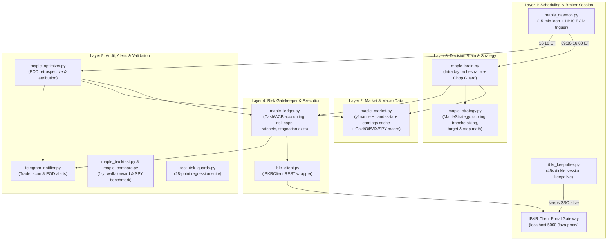

# MAPLE: Architecture & System Design Guide

> **Purpose of this document:** A clear, plain-English technical walkthrough of **MAPLE** (**M**arket **A**nalyzer & **P**ortfolio **L**edger **E**ngine) — how its components fit together, how data flows from market close to live order execution, and why its multi-layered risk architecture prioritizes capital preservation over trade frequency.

---

## 1. What Is MAPLE?

MAPLE is a self-contained, autonomous swing-trading system for **US equities (NYSE & NASDAQ)**.

Instead of relying on external cloud trading platforms, paid signal feeds, or a heavy database cluster, MAPLE runs locally in Python using standard market data (`yfinance`), local technical analysis (`pandas-ta`), flat-file accounting, and a direct REST connection to **Interactive Brokers (IBKR)** via the local **Client Portal Gateway**.

### Core Design Principles
1. **Capital Preservation First:** Most market scans result in **zero trades**. Every candidate must pass technical, volume, macro, event, and portfolio-concentration gates before a single dollar is risked.
2. **Strict Shariah Compliance:** MAPLE only evaluates a hardcoded **47-ticker** US equity universe pre-vetted for AAOIFI financial ratios and business-activity compliance across 6 sectors (*Technology, Healthcare, Energy, Industrials, Consumer, Materials*).
3. **Dual-Mode Execution:** The exact same decision engine runs in **LIVE** mode (routing real Limit Orders to IBKR `SMART` USD) or **SIMULATED** mode (risk-free paper trading).
4. **No Heavy Infrastructure:** All configuration, trade history, NAV snapshots, and daily audit logs live in human-readable JSON, CSV, and Markdown files.

---

## 2. High-Level Architecture (The 5-Layer Stack)

MAPLE is organized into five clean layers, where each file has one clear job:



### What Each Module Owns

| Layer | File | Role in Plain English |
| :--- | :--- | :--- |
| **1. Scheduling** | `maple_daemon.py` | The heartbeat. Wakes up every 15 minutes during US market hours (`09:30–16:00 ET`), runs the Brain, and triggers the EOD Optimizer after close (`~16:10 ET`). |
| **1. Session** | `ibkr_keepalive.py` | Pings IBKR's local gateway (`/v1/api/tickle`) every 45 seconds so the authenticated brokerage session does not time out mid-day. |
| **2. Market Data** | `maple_market.py` | Fetches historical/intraday price bars via `yfinance`, computes indicators (`EMA5`, `EMA9`, `RSI`, `ADX`, `ATR`, pace-adjusted volume ratio), caches earnings dates for 24 hours, and reads macro signals (`GC=F` Gold, `CL=F` Crude Oil, `^VIX`, `SPY` 50-SMA). |
| **3. Brain** | `maple_brain.py` | The intraday conductor. Checks market hours, runs the Opening Chop Guard (`09:30–10:00 ET`), overlays live IBKR Level-1 quotes onto `maple_market` indicators, evaluates all 47 tickers, and routes approved orders to the Ledger. |
| **3. Strategy** | `maple_strategy.py` | Pure strategy math (`MapleStrategy`). Decides *how big* a position should be (`15%–35%` tranche) and calculates exact entry limit, profit target, and stop-loss prices. |
| **4. Ledger** | `maple_ledger.py` | The accountant and bouncer. Tracks cash, Adjusted Cost Basis (ACB), sector exposure, capital flows, and Time-Weighted Return (TWR). Enforces all hard risk limits, ratchets stop-losses upward as profits grow, and triggers 4-day stagnation exits. |
| **4. Broker API** | `ibkr_client.py` | Talks to the local IBKR Client Portal Gateway over HTTPS (`localhost:5000/v1/api`) to fetch live balances, positions, quotes, and submit/cancel/verify Limit Orders. |
| **5. Optimizer** | `maple_optimizer.py` | Runs after market close. Computes daily/weekly NAV changes, benchmarks against the 47-ticker universe, audits "filtered non-held movers" to prove risk blocks worked, and writes the daily report. |
| **5. Alerts & Tools** | `telegram_notifier.py`, `maple_compare.py`, `maple_backtest.py`, `test_risk_guards.py` | Dispatches real-time Telegram notifications, compares portfolio returns to `SPY`, runs 1-year read-only backtests, and verifies 28 core safety rules before live capital runs. |

---

## 3. How One Trading Day Flows (Step-by-Step)

```mermaid
sequenceDiagram
    participant User
    participant GW as IBKR Gateway (:5000)
    participant Daemon as maple_daemon.py
    participant Brain as maple_brain.py
    participant Market as maple_market.py
    participant Ledger as maple_ledger.py
    participant Opt as maple_optimizer.py

    User->>GW: Morning login + 2FA (https://localhost:5000)
    Note over Daemon: 09:30 - 10:00 ET (Opening Chop Guard)
    Daemon->>Brain: Run exit-only check (no new buys)
    Brain->>Ledger: Harvest profit targets & apply -2.0% chop stop buffer

    Note over Daemon: 10:00 - 15:45 ET (Every 15 minutes)
    Daemon->>Brain: run_intraday_scan()
    Brain->>Ledger: 1. Sync working orders & check stops/ratchets/stagnation
    Brain->>Market: 2. Prefetch 47 tickers + earnings + macro (VIX, SPY, Gold, Oil)
    Brain->>GW: 3. Overlay live IBKR Level-1 quotes
    Brain->>Ledger: 4. Submit approved BUY/SELL Limit Orders

    Note over Daemon: ~16:10 ET (Post-Close Audit)
    Daemon->>Opt: run_daily_self_assessment()
    Opt->>User: Log to maple_logic_changelog.md + send Telegram EOD report
```

### Phase 1: Morning Startup (Pre-Market)
1. Run `test_risk_guards.py` to verify all 28 mathematical safety rules pass.
2. Start the IBKR Client Portal Gateway (`start_ibkr_gateway.bat`) and log in once with 2FA at `https://localhost:5000`.
3. Start `ibkr_keepalive.py` (keeps the session alive every 45s) and `maple_daemon.py` (waits in standby until `09:30 ET`).

### Phase 2: Opening Chop Guard (`09:30 – 10:00 ET`)
The first 30 minutes of the US market often have wide spreads and fake "stop-hunt" wicks.
- **Zero New Buys:** MAPLE refuses to open new positions during this window.
- **Target Harvesting:** If a held stock spikes above its profit target at the open, MAPLE sells to lock in gains.
- **Chop Stop Buffer:** Regular stop-losses get a temporary **`2.0%` buffer** so an opening wick does not shake MAPLE out of a healthy position prematurely.

### Phase 3: Regular Intraday Scans (`10:00 – 15:45 ET`, every 15 min)
Every 15 minutes, `run_intraday_scan()` runs in strict order:
1. **Exits Before Entries:** First, `check_target_stops()` checks all held positions for profit targets, stop-losses, upward stop ratchets, or 4-day stagnation exits.
2. **Data & Live Quote Overlay:** `maple_market.py` computes daily/intraday technical indicators across all 47 tickers. In `LIVE` mode, `maple_brain.py` queries IBKR Level-1 quotes to replace delayed prices with real-time bid/ask/last prices.
3. **Macro Regime Check:** Evaluates Gold (`GC=F`), Crude Oil (`CL=F`), Volatility (`^VIX`), and `SPY` vs. its 50-day Simple Moving Average (`50-SMA`).
4. **Candidate Filtering & Sizing:** Any ticker that passes all entry filters is sized by `MapleStrategy` (`15%–35%` of NAV, or a **1-share whole-lot floor** up to `30%` of NAV for smaller accounts).
5. **Marketable Limit Orders:** `maple_ledger.py` places Limit Orders via `IBKRClient` (never blind market orders), records fills in `maple_trades.csv`, and alerts via Telegram.

### Phase 4: Post-Close Retrospective (`~16:10 ET`)
After the closing bell, `maple_optimizer.py` runs `run_daily_self_assessment()`:
- Records the end-of-day portfolio snapshot in `maple_daily_nav.json`.
- Detects external cash deposits/withdrawals (`reconcile_capital_flows()`) so Time-Weighted Return (TWR) stays accurate.
- Compares portfolio return against the **47-ticker equal-weight universe benchmark** to measure relative alpha.
- Audits **Filtered Non-Held Movers** (stocks that moved up but were intentionally blocked by a guard) and **Signal Attribution** (which entry type drove today's fills).
- Appends the full report to `maple_logic_changelog.md` and sends a formatted summary to Telegram.

---

## 4. The Signal & Sizing Engine (`MapleStrategy`)

MAPLE classifies every buy candidate into one of three distinct setup buckets:

| Signal Type | What It Looks For | Key Constraints |
| :--- | :--- | :--- |
| **Regular Trend** | `EMA5 > EMA9`, `ADX >= 15.0`, healthy `RSI` (`<= 68.0`), price not overextended (`<= 3.0%` above `EMA5`), and strong volume. | If volume is surging (`>= 1.50x`) while trend strength is weak (`ADX < 20`), it uses the **Single-Bypass** rule — capped at `15%` tranche and gated if `SPY < 50-SMA`. |
| **Low-Volume Scaled Entry** | Established trend (`EMA5 > EMA9`) with decent `ADX` and healthy `RSI`, even without a massive volume spike. | Requires at least `1.00x` pace-adjusted intraday volume (`MIN_SCALED_VOL_RATIO`). |
| **Capitulation Reversal** | Oversold mean-reversion bounce (`RSI <= 35.0`), high volume (`>= 1.25x`), green intraday candle (`Price > Open`), and a `1.50%–4.50%` rebound off the intraday low. | Capped at `15%` tranche, `+3.5%` profit target, and **gated whenever `SPY < 50-SMA`** to avoid catching falling knives in a downtrend. |

### Commission-Aware Target Math
Because small trades can get eaten by brokerage fees, `MapleStrategy.calculate_targets()` factors in round-trip IBKR commissions (`$1.00` per side = `$2.00` minimum drag) so that every profit target guarantees at least **`+2.5%` net return** after fees.

---

## 5. The Defense Stack (Why MAPLE Says "No" Most of the Time)

MAPLE's edge comes from stacking independent layers of protection so a single bad market day cannot cause a cascade of losses:

1. **Portfolio & Sector Caps:**
   - Maximum **`35%`** of NAV in any single sector (e.g., Technology, Consumer, Healthcare).
   - Maximum **`35%`** of NAV in any single stock (`max_position_pct`).
   - Dynamic minimum trade size (`min_trade_cad`) to prevent fee churn on tiny orders.
2. **Macro & Event Shields:**
   - **VIX Panic Gate:** When `^VIX >= 25` or spikes `>= +10%`, non-commodity entries are suppressed.
   - **SPY 50-SMA Gate:** When the broader market (`SPY`) is below its 50-day moving average, higher-risk `Single-Bypass` and `Capitulation Reversal` entries are blocked.
   - **Commodity Alignment:** Gold miners/materials (`NEM`, `FCX`) and Energy stocks check `GC=F` and `CL=F` direction.
   - **Earnings Binary Shield:** Blocks new buys within **3 trading days** of a company's scheduled quarterly earnings call (cached in `corporate_calendar_cache.json`).
3. **Intraday Candle & Timing Guards:**
   - **Intraday Red-Candle Guard:** Blocks buying into a falling red candle (`Price <= Open`).
   - **Stale-Bar Guard:** Refuses to act on outdated price bars.
   - **Scale-In & Re-Entry Cooldowns:** Max 2 entries per position cycle, 4-hour cooldown between scale-ins or after a stop/stagnation exit, plus a `+0.5%` / `+1.0%` price progress hurdle over Entry #1.
4. **Automated Exit & Ratchet Rules:**
   - **Tiered Stop Ratchets** (automatically moves your stop-loss up as unrealized profit grows):
     - `+2.0%` gain → **Tier 0.5 Half-Risk** (`-2.5%` below ACB)
     - `+2.5%` gain → **Tier 1 Breakeven** (`ACB + $0.50`)
     - `+3.0%` gain → **Tier 2 Profit-Lock** (`+1.5%` net above ACB)
     - `+4.5%` gain → **Tier 3 Trailing Stop** (`-1.25%` below live price)
   - **4-Day Stagnation Exit:** If a losing position is held `>= 4` trading days with bearish EMA alignment (`EMA5 < EMA9` or below both), MAPLE exits to free up capital (unless it is actively rallying intraday).
   - **Daily Drawdown Circuit Breaker:** Halts all new buying if daily equity drops past the configured loss threshold (`daily_loss_limit_cad` / `4%` equity guard).

---

## 6. Flat-File State & Persistence

MAPLE avoids database overhead by storing all state in local workspace files:

- `maple_config.json` — Active mode (`LIVE` / `SIMULATED`), IBKR account ID, risk limits, and the 47-ticker `allowed_tickers` list.
- `maple_trades.csv` — Append-only trade ledger (timestamp, ticker, side, shares, fill price, remaining shares, cash after trade, and exact rule/reason string).
- `maple_daily_nav.json` — Daily closing NAV, cash balance, and open position snapshots.
- `maple_logic_changelog.md` — Chronological EOD retrospective reports and weekly summaries.
- `maple_advice_history.txt` — Detailed intraday signal/filter evaluation log.
- `corporate_calendar_cache.json` & `ibkr_symbols_cache.json` — Local caches to minimize API calls for earnings dates and IBKR contract IDs (`conid`).

---

## 7. Offline Testing & Validation

Before running live capital, MAPLE provides two standalone verification tools:
- **`test_risk_guards.py`**: A 28-point automated regression suite that mocks market conditions to verify every sector cap, ratchet tier, chop buffer, VIX/SPY gate, cooldown, and live IBKR fill confirmation works as designed.
- **`maple_backtest.py` & `maple_compare.py`**: Read-only CLI tools to run 1-year walk-forward backtests and compare MAPLE's live/simulated equity curve against the S&P 500 (`SPY`).
